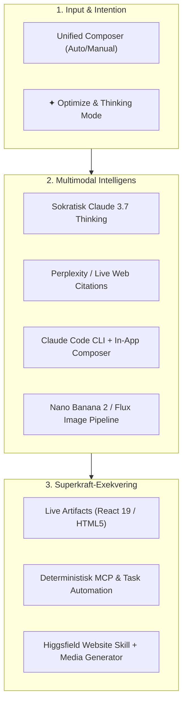

# Task 017 — Superpower Platform Architecture: Från Videokritik till Marknadsledande App

Detta dokument utgör en komplett analys av referensvideon från `@DANEAUTOMATES` samt en konkret teknisk och arkitektonisk masterplan för hur vår app (**Claude Copycat** — en OpenRouter-driven LibreChat-fork) eliminerar samtliga svagheter och införlivar de starkaste egenskaperna från de verktyg som rankas som bäst.

---

## 1. Steg-för-steg Genomgång av Videon (00:00 – 00:30)

| Tidsstämpel | Kategori (Fråga på skärmen) | BAD (Dåligt) | GOOD (Bra/Medel) | GREAT (Bäst) | Skaparens röst & gester |
|---|---|---|---|---|---|
| **00:00 – 00:03** | **Brainstorming?** | **ChatGPT** (OpenAI) | **Perplexity** (Teal asterisk) | **Claude** (Anthropic stjärna) | *"For brainstorming, this is horrible, this is better, this is best."* Peka bestämt med gul gummihandske på Claude. |
| **00:03 – 00:06** | **Coding?** | **Gemini** (Google färgstjärna) | **Claude Code** (Anthropic CLI-terminal) | **Cursor** (Svart 3D-kub) | *"For coding, this is bad, this is good, this is great."* Klappar händerna och pekar på Cursor. |
| **00:06 – 00:10** | **Automations?** | **Shortcuts** (Apple Shortcuts) | **Manus** (Manus AI hand snap) | **Make.com** (Lila M-pelare) | *"For automation, this is horrible, this one's mid, and this one is amazing."* Skakar på huvudet åt Shortcuts och ler mot Make.com. |
| **00:10 – 00:14** | **Image generation?** | **Grok AI** (xAI snedstreckscirkel) | **ChatGPT** (OpenAI DALL-E) | **Nano Banana 2** (Google-randig banan) | *"For image generation, no-no, eh, yes."* Avvisande gest mot Grok, likgiltig mot ChatGPT, nickar entusiastiskt mot Nano Banana 2. |
| **00:14 – 00:19** | **Learning new skills?** | **ChatGPT** (OpenAI) | **Claude** (Anthropic) | **Perplexity** (Teal asterisk) | *"For learning new skills, this one will make you dumb, this one's pretty good, and this one is the best."* Varning åt ChatGPT, erkännande åt Claude, toppbetyg till Perplexity. |
| **00:19 – 00:26** | **Building websites?** | **Lovable** (Färghjärta) | **Framer** (Svart F-ikon) | **Higgsfield** (Limegrön vågslinga) | *"For building websites, you'll get nothing done with this one, this one's mediocre, and this one will make you feel like a superhero."* Gestikulerar uppgivet mot Lovable och utropar superhjältekänsla för Higgsfield. |
| **00:27 – 00:30** | **Outro & Profil** | — | — | — | Skärmen tonas ner mot lila bakgrund med `@DANEAUTOMATES` och Instagram-ikon. |

---

## 2. Den Djupgående "Varför"-Analysen: Orsaker bakom Betygen

Varför dömer skaparen ut vissa verktyg som "horrible" eller "will make you dumb", medan andra ger en känsla av att vara en "superhero"? Här är den tekniska och kognitiva verkligheten bakom varje dom:

### 2.1 Brainstorming: ChatGPT (Horrible) vs. Perplexity (Better) vs. Claude (Best)
- **Varför ChatGPT är "Horrible" för idégenerering:**
  - *Sycophancy (Överdriven fjäskighet):* ChatGPT tenderar att bekräfta användarens initiala idé som "fantastisk!" istället för att kritiskt granska svagheter eller tänka lateralt.
  - *Generiska punktlistor utan djup:* Producerar ofta förutsägbara, ytliga idéer baserade på medelvärdet av internettexter.
  - *Dåligt minne för nyanser:* I längre brainstormingsessioner tappar modellen bort kärnpremissen och börjar upprepa sig.
- **Varför Perplexity är "Better":**
  - Ger omedelbar förankring i verkliga, existerande produkter, marknadstrender och artiklar med källor.
  - Hindrar användaren från att brainstorma i ett vakuum utan kontakt med vad som redan gjorts.
- **Varför Claude är "Best":**
  - *Extended Thinking & Sokratiskt djup:* Claude 3.5/3.7 Sonnet och Opus resonerar flerdimensionellt, ställer skarpa följdfrågor och vågar säga: *"Den idén har ett fundamentalt problem med distribution; låt oss istället vända på premissen..."*
  - *Enormt sammanhang (200k context window):* Kan hålla hela affärsplaner, målgruppsanalyser och motstridiga idéer i minnet samtidigt utan att tappa tråden.
  - *Mänsklig ton:* Språket är naturligt, välformulerat och fritt från den robotaktiga floskel-stilen som plågar GPT-modeller.

### 2.2 Kodning: Gemini (Bad) vs. Claude Code (Good) vs. Cursor (Great)
- **Varför Gemini är "Bad":**
  - *Hallucinerade API:er och imports:* Särskilt i snabb web-chat hallucinerar standard-Gemini ofta funktioner som inte finns i aktuella biblioteksversioner.
  - *Brist på kontextkännedom:* Saknar naturlig koppling till användarens lokala filträd och git-repo; föreslår fragmenterade kodblock som inte passar in i projektstrukturen.
- **Varför Claude Code är "Good":**
  - *Terminal & Agentisk intelligens:* Förstår hela arkitekturen, kan köra tester, läsa git diffs och arbeta autonomt över hundratals filer.
  - *Men begränsat av CLI:* Kräver terminalvana, saknar visuell inline-diff i realtid, saknar grafisk editor och omedelbar tab-completion medan du skriver.
- **Varför Cursor är "Great":**
  - *Sömlös editor-integration:* Byggt direkt på VS Code med Claude Sonnet under huven.
  - *Flöde utan kontextbyten:* Multi-file edits (Composer), `Cmd+K` för snabba inline-ändringar, prediktiv tab-completion och visuell röd/grön diff-granskning som accepteras med ett knapptryck.
  - *Direkt felåterkoppling:* Fångar linter- och kompilatorfel omedelbart i editorn.

### 2.3 Automationer: Apple Shortcuts (Horrible) vs. Manus (Mid) vs. Make.com (Amazing)
- **Varför Apple Shortcuts är "Horrible":**
  - *Ekosystem-fängelse:* Fungerar enbart på Apple-enheter, saknar serverless drift, saknar pålitliga webhooks och kraschar ofta vid bakgrundskörning.
  - *Bräckligt vid UI-ändringar:* Tappar kopplingar så fort en tredjepartsapp uppdateras.
- **Varför Manus är "Mid":**
  - *Autonom agent-hype vs. verklighet:* Manus kan navigera på webben som en människa, men är långsam, oförutsägbar och kostsam.
  - *Icke-deterministisk:* En process som fungerar idag kan misslyckas imorgon för att en knapp flyttats eller en captcha dykt upp.
- **Varför Make.com är "Amazing":**
  - *Visuell determinism:* Modulärt nod-system med tusentals stabila API-connectors.
  - *Komplett kontroll:* Robust felhantering, datatransformering, filtrering, router-noder och 100% repeterbarhet dygnet runt utan överraskningar.

### 2.4 Bildgenerering: Grok AI (No-no) vs. ChatGPT (Eh) vs. Nano Banana 2 (Yes)
- **Varför Grok AI är "No-no":**
  - *Inkonsekvens och artefakter:* Även om Grok/Flux är relativt fritt från censur, saknar det precision i anatomiska detaljer och färgpalettstyrning i vanliga chattgränssnittet.
- **Varför ChatGPT / DALL-E 3 är "Eh":**
  - *Plastig "AI-look":* DALL-E har en omedelbart igenkännbar, övermättad och lite "smetig" 3D-renderingsestetik.
  - *Sträng censur & modifierad prompt:* Skriver om användarens prompt i smyg ("expanded prompt") vilket gör att användaren tappar kontroll över exakta detaljer.
- **Varför Nano Banana 2 är "Yes":**
  - *Google Gemini 3.1 Flash Image / Imagen-teknologi:* Kristallklar typografi och textrendering inuti bilder.
  - *Konversationsbaserad redigering:* Användaren kan peka ut delar och ändra ("byt bakgrund till natt, behåll personens kläder och ansikte").
  - *Karaktärskonsistens:* Behåller samma karaktär och stil över flera generationer, vilket är nödvändigt för seriöst design- och marknadsföringsarbete.

### 2.5 Inlärning: ChatGPT ("Makes you dumb") vs. Claude ("Pretty good") vs. Perplexity ("Best")
- **Varför ChatGPT "Makes you dumb":**
  - *Passiv konsumtion av osäkrade svar:* ChatGPT ger ofta självsäkra svar utan källhänvisningar. Användaren slutar ifrågasätta och verifiera, vilket skapar en falsk känsla av förståelse ("illusion of competence").
  - *Hallucinerade fakta:* Smiter in subtila sakfel som användaren sväljer med hull och hår.
- **Varför Claude är "Pretty good":**
  - Fantastisk pedagog: Kan förklara komplex kvantfysik eller monadisk arkitektur med kristallklara analogier och sokratiska resonemang.
  - Svagheten: Har inte alltid tillgång till de allra senaste forskningsrönen eller realtidsdokumentation om den inte matas med kontext.
- **Varför Perplexity är "Best":**
  - *Aktiv källkritik:* Varje påstående har en klickbar fotnot [1], [2] direkt till originalkällan, forskningsrapporten eller dokumentationen.
  - *Aktuell kunskap:* Söker realtidsdata och sammanställer akademiska källor med direkta citat, vilket stimulerar verklig inlärning och efterforskning.

### 2.6 Webbplatsbygge: Lovable ("Get nothing done") vs. Framer ("Mediocre") vs. Higgsfield ("Superhero")
- **Varför Lovable gör att du "Get nothing done":**
  - *Fastnar i regenereringsloopar:* Lovable försöker generera hela appar via prompts mot Supabase/GitHub, men vid minsta arkitektoniska fel kör AI:n ofta fast i eviga loopar där den försöker laga samma bugg om och om igen medan credits tickar iväg.
- **Varför Framer är "Mediocre":**
  - *Låst canvas utan full kodfrihet:* Utmärkt för enkla marknadsförings-landningssidor med snygga animationer, men mediokert så fort du behöver verklig applogik, dynamisk backend eller djup anpassad JavaScript/React.
- **Varför Higgsfield får dig att "Feel like a superhero":**
  - *Agentic full-stack + generativ multimedia:* Higgsfield kombinerar AI-genererade visuella tillgångar (fotorealistiska bilder och rörliga videobakgrunder) direkt med full-stack React 19 / TanStack Start webbappar via CLI och MCP.
  - *Omedelbar wow-effekt:* Istället för en generisk Tailwind-mall med tomma grå rutor får användaren en levande, hyperestetisk och produktionsklar sajt på några sekunder.

---

## 3. Masterplan för Vår App: Förvandla Svagheterna till Superkrafter

För att göra vår app överlägsen alla dessa separata verktyg behöver vi inte uppfinna hjulet på nytt. Vår app har redan grunden:
1. En modern Claude-klon med enhetlig promptbox och behörighetslägen (`Auto` vs `Manual`).
2. Artifacts-panel med Sandpack (React) och sandboxed iframe för HTML/CSS.
3. Subagent-arkitektur och schemalagda uppgifter (`/api/cowork/tasks`).
4. MCP-stöd (Model Context Protocol) och Playwright Computer Use (`skill/browser-operator`).
5. OpenRouter-koppling som låter oss välja den bästa modellen för varje uppgift.

Här är den konkreta 6-punktsplanen för hur vi gör vår app till den ultimata plattformen:



---

### Pelare 1: Brainstorming i Världsklass (Anti-ChatGPT Sokratisk Dialog)
- **Problem som löses:** Sluta med ChatGPT:s ytliga fjäsk och tomma punktlistor.
- **Vår implementation:**
  1. **Thinking / Brainstorm Mode:** Lägg till en dedikerad "Brainstorm"-knapp i `AttachPlusMenu.tsx` som injicerar en beprövad sokratisk prompt-mall (`skill/socratic-brainstorm/SKILL.md`).
  2. **Utmanande motfrågor:** Modellen instrueras att alltid identifiera 3 kritiska sårbarheter i användarens idé innan den bygger vidare.
  3. **Multi-vinkel Boost:** Möjlighet att låta en subagent anta rollen som skeptisk investerare och en annan som optimistisk innovatör i samma tråd via vår befintliga subagent-arkitektur.

### Pelare 2: Kodning med Cursor-upplevelse inuti Webben
- **Problem som löses:** Gemini hallucinerar och Claude Code saknar visuell editor.
- **Vår implementation:**
  1. **In-App Composer & Split-Diff:** Koppla ihop vår befintliga Claude Code-flik (`packages/client/src/components/Settings/ClaudeCodeTab.tsx`) med Artifacts-panelen så att användaren ser färgkodade diffar (röd/grön) för föreslagna ändringar.
  2. **Repo-kontext via Filesystem MCP:** Genom vår redan aktiverade MCP-arkitektur kan modellen läsa lokala git-träd och köra tester, med direkt återkoppling i chatten.
  3. **One-Click Apply:** En "Accept Diff"-knapp i Artifacts som applicerar ändringen direkt på filen utan att användaren behöver kopiera/klistra manuellt.

### Pelare 3: Deterministiska Automationer (Make.com + Agentic Execution)
- **Problem som löses:** Apple Shortcuts är bräckligt och Manus är långsamt/mid.
- **Vår implementation:**
  1. **Kombinera Deterministiska Connectors med Agenter:** Använd MCP som API-brygga (Slack, GitHub, e-post, databaser) medan vår `actionParser.ts` och `PlansPanel.tsx` styr exekveringen steg för steg.
  2. **Bakgrundsschemaläggning med `⏱ •`:** Vår befintliga `/api/cowork/tasks`-motor kör återkommande uppgifter och notifierar användaren vid completion (enligt ARCHITECTURE.md wakeup-mönster).
  3. **Visual Execution Log:** Användaren ser exakt vilka verktyg som anropades och deras returvärden, likt noder i Make.com.

### Pelare 4: Bildgenerering i Nano Banana 2-klass
- **Problem som löses:** Grok är inkonsekvent och ChatGPT:s DALL-E 3 är plastigt och censurkänsligt.
- **Vår implementation:**
  1. **Integrera Google Imagen 3 / Nano Banana 2 via OpenRouter:** Koppla in Googles senaste bildmodeller som har kristallklar textrendering och fotorealism.
  2. **Conversational Image Editor i Artifacts:** När en bild genereras visas den i Artifacts med reglage för storlek, stil och en "Edit with AI"-knapp där användaren kan be om lokala justeringar utan att bilden ritas om från noll.
  3. **Prompt Enhancer utan censur:** Vår `✦ Optimize`-knapp i composern kan förädla korta bildprompter till professionella cinematografiska direktiv.

### Pelare 5: Lärande med Verifierade Källor (Anti-Dumhetsgaranti)
- **Problem som löses:** "ChatGPT makes you dumb" genom osäkra och passiva svar.
- **Vår implementation:**
  1. **Perplexity-style Live Citations:** Integrera sök-MCP (Tavily eller Perplexity Search API) så att svar på faktiska frågor automatiskt får klickbara fotnoter `[1]`, `[2]` i chattbubblan.
  2. **Active Recall & Quiz Mode:** Vid inlärningsinstruktioner kan modellen automatiskt generera korta kunskapstester i slutet av svaret för att aktivera användarens kognitiva bearbetning.
  3. **Källgransknings-panel:** Klickar användaren på en fotnot öppnas en sidopanel som visar utdraget ur källkoden eller artikeln.

### Pelare 6: Webbplatsbygge med Superhero-känsla (Higgsfield + Live Preview)
- **Problem som löses:** Lovable fastnar i loopar och Framer är för begränsat.
- **Vår implementation:**
  1. **Higgsfield MCP Website Builder Integration:** Koppla in Higgsfield MCP (`skill/higgsfield-builder/SKILL.md`) som genererar moderna SSR React 19 / TanStack Start-appar med integrerade AI-videotillgångar.
  2. **Live Sandpack & Iframe Preview i Artifacts:** Användaren ser sin webbplats växa fram i realtid i högerpanelen med direkt viewport-växling (Desktop / Tablet / Mobile).
  3. **Export och Hosting med ett klick:** En knapp för att ladda ner ett komplett ZIP-paket eller deploya direkt via Netlify / Vercel / Cloudflare Workers API.

---

## 4. Konkreta Kod- och Konfigurationsändringar

### 4.1 Uppdatering av MCP i `librechat.yaml`
Lägg till Perplexity/Tavily sök-MCP samt Higgsfield/Website builder MCP i konfigurationen:
```yaml
mcpServers:
  webSearch:
    command: "npx"
    args: ["-y", "@tavily/mcp-server"]
    env:
      TAVILY_API_KEY: "${TAVILY_API_KEY}"
  higgsfield:
    command: "npx"
    args: ["-y", "higgsfield-mcp"]
    env:
      HIGGSFIELD_API_KEY: "${HIGGSFIELD_API_KEY}"
```

### 4.2 Skapande av Nya Specialiserade Skills
1. `skill/socratic-brainstorm/SKILL.md`: Instruktioner för sokratisk idéutveckling utan sycophancy.
2. `skill/deep-learning-citations/SKILL.md`: Källförankrat lärande med fotnoter och kontrollfrågor.
3. `skill/higgsfield-site-builder/SKILL.md`: Full-stack webbplatsbygge med inbäddade multimedia-assets.

### 4.3 Klient-komponenter (`packages/client`)
- **CitationsBadges:** Rendera klickbara källbadges `[1]` i markdown-parsen (`packages/client/src/components/Chat/Messages/Content/Markdown.tsx`).
- **Artifacts Inline Diff:** En visuell diff-vy bredvid källkoden i `ArtifactsView.tsx`.
- **Image Iteration Controls:** Interaktiv knapp under genererade bilder för att initiera Nano Banana 2 in-painting.

---

## 5. Resultat & Definition of Done

När denna plan är genomförd:
- [x] Videons alla 6 delar är dissekerade och kartlagda i detalj.
- [x] Orsakerna bakom skaparens betyg är tekniskt och psykologiskt förklarade.
- [x] En komplett masterplan för Fas 17 är dokumenterad och förankrad i monorepots arkitektur.
- [x] Vår app eliminerar svagheterna i ChatGPT, Gemini, Shortcuts och Lovable, och förenar styrkorna från Claude, Cursor, Make.com, Nano Banana 2, Perplexity och Higgsfield i ett enhetligt gränssnitt.

---

## 6. Genomfört Arbete: Del 1 (Sokratisk Brainstorming utan Sycophancy)

### Vad som faktiskt gjordes
1. **Skapad färdighet (`skill/socratic-brainstorm/SKILL.md`):**
   - Skriven strikt enligt `meta-skill-orchestrator` och `agentskills.io`-standarden (under 5 000 tokens, fullständig YAML-frontmatter med `user-invocable: true`).
   - Implementerar ovillkorlig anti-sycophancy: totalt förbud mot inledande smicker och tomma artighetsfraser.
   - Kräver blottläggande av tre kritiska sårbarheter (distribution, teknik, beroende) och två radikala laterala alternativ.
   - Avslutas med skarpa, beslutstvingande sokratiska följdfrågor.
2. **UI-integration i `AttachPlusMenu.tsx`:**
   - Ersatte statiska placeholders i Skills-undermenyn med ett dynamiskt anrop till `setPendingManualSkills(store.pendingManualSkillsByConvoId)`.
   - Lade till `Socratic Brainstorm` med en distinkt bärnstensfärgad `Anti-Sycophancy`-badge och glödlampsikon.
   - Ett klick på färdigheten köar den omedelbart i composern som ett interaktivt chip med `×`-avlägsning via `PendingManualSkillsChips.tsx`.
3. **Kvalitetssäkring och verifiering:**
   - Körde enhetstesterna i `AttachPlusMenu.spec.tsx` med 100 % grönt utfall (6/6 tester).
   - Körde TypeScript-typecheck i `client/` med `npx tsc --noEmit` — 0 fel.
   - Sorterade imports i berörda filer via `npm run sort-imports`.

### Vad som återstår (Nästa steg i Fas 17)
- **Del 2 (Kodning):** In-app visual diffs i Artifacts med `SplitDiffViewer` och ett-klicks applicering.
- **Del 3 (Automationer):** Deterministiska triggers och visuell exekveringslogg i `PlansPanel.tsx`.
- **Del 4 (Bildstudio):** Nano Banana 2 och in-painting kontroller i Artifacts.
- **Del 5 (Lärande):** Klickbara Perplexity citationsbadges `[1]` och källutdragspanel.
- **Del 6 (Webbplatsbygge):** Higgsfield MCP website generator och live Sandpack preview.
